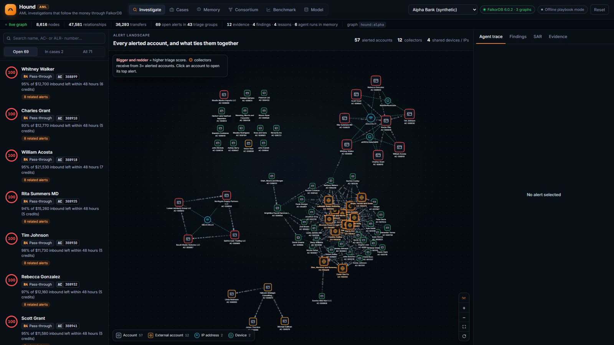
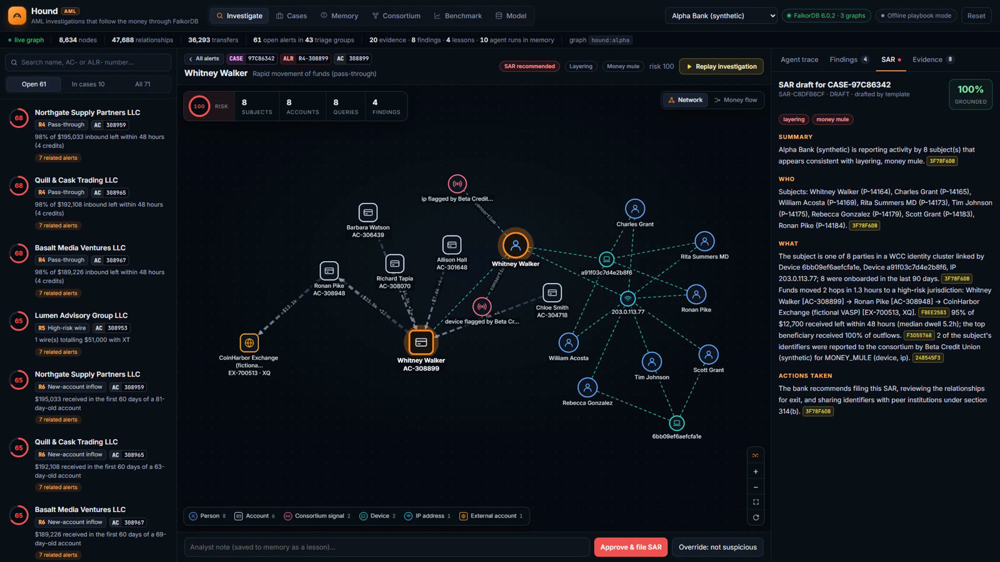
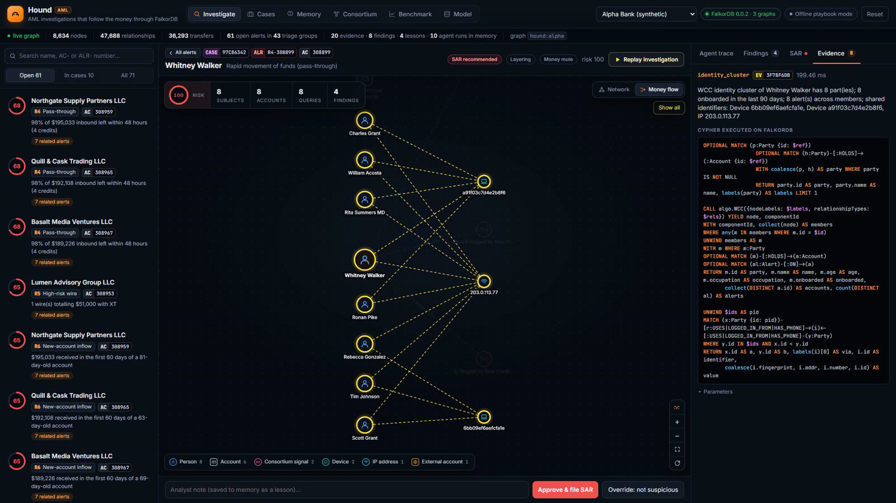
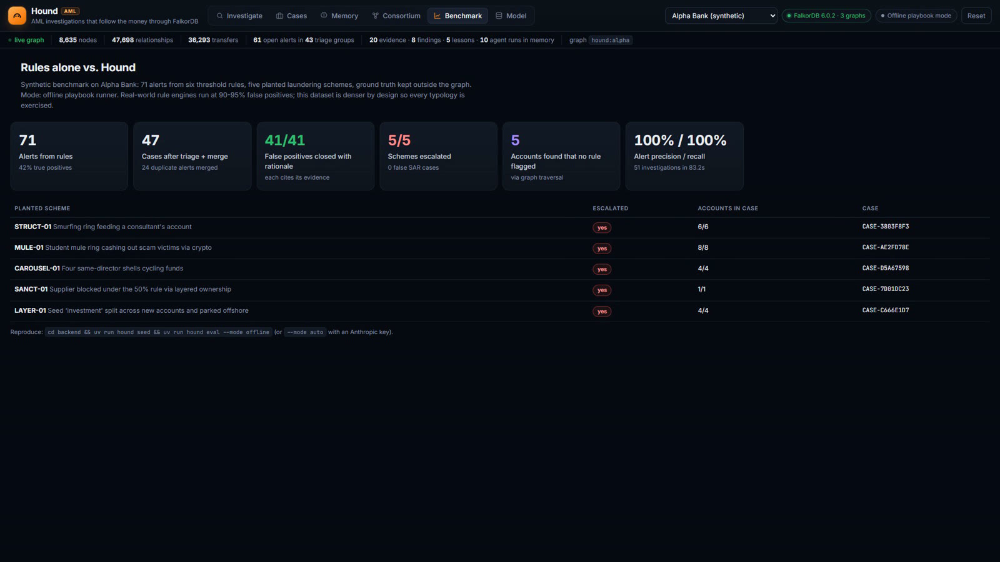

# I work in AML. So I built an agent that follows the money through a graph

*Published on [Hashnode](https://team-musketeer.hashnode.dev/i-work-in-aml-so-i-built-an-agent-that-follows-the-money-through-a-graph).*

Most of my working day in anti-money-laundering is spent proving alerts wrong. Not catching criminals. Proving that the payroll company paying 160 people is, in fact, a payroll company.

So when Graph Hacks 2026 came around, I didn't want to build a chatbot. I wanted to build the thing I actually wish I had at work. My team (Team Musketeer) and I ended up with Hound.

**Demo video:** [youtu.be/vA2FIvR-nkA](https://youtu.be/vA2FIvR-nkA)

**Live demo:** [hound-99l2.onrender.com](https://hound-99l2.onrender.com) · **Code:** [github.com/manav-Mnv/hound-aml](https://github.com/manav-Mnv/hound-aml)

## Why alerts are such a pain

Banks run simple rules over every transaction. Too much cash, too many transfers out, money to a risky country. The rules fire all day. A NICE Actimize industry survey put it bluntly: almost 95% of alerts turn out to be false positives.

Each one still gets a human. That person opens five systems, copies account numbers into a spreadsheet, checks phone numbers by hand, and sometimes finds out a colleague is working the same ring from a different alert. And the ones that aren't false positives really matter. In 2024 TD Bank paid about $3 billion after laundering networks moved hundreds of millions through it.

Here's the thing I keep coming back to. Whether an alert is real is almost never in the alert. It's in the connections. Who else logs in from this phone? Where did the money go next? Who actually owns this supplier? Did someone already clear this customer last month? Those are graph questions. So we built Hound on a graph.

## One graph for everything

Hound loads two made-up banks into FalkorDB as two separate graphs, `hound:alpha` and `hound:beta`, on one instance. A third graph, `hound:consortium`, holds nothing except hashed identifiers that the banks have flagged. Customers, accounts, phones, devices, IPs, addresses, companies and ownership stakes are all nodes. Transfers and cash deposits are edges with amounts and timestamps.

The decision I'm happiest with: the agents' memory lives in the same graph as the money. A case is a node connected to the people it's about. Every query an agent runs is saved as an Evidence node with the exact Cypher and parameters. Findings point to evidence. SARs point to evidence. When an analyst writes a lesson ("this company pre-funds payroll, it's fine"), that lesson hangs off the company itself. So "have we seen this before?" isn't a search any more. It's two hops.

## How the agents work

Six ordinary rules, written in Cypher, produce 71 alerts. A triage agent scores all 71 in about 200 ms using graph features: identity clusters from WCC, PageRank, account age, past false positives, consortium hits. It also groups alerts that belong to the same ring, so 71 alerts become 43 candidate cases before anyone opens one.

The investigator has 17 tools. Some are multi-hop Cypher: follow money forward in time, find loops that come back to where they started, find cash deposited in one place and sent on within 48 hours. Some are FalkorDB's built-in algorithms (WCC, PageRank, betweenness, label propagation). One lets it write its own read-only Cypher, which runs through `GRAPH.RO_QUERY`, so the database itself won't let it change anything. Before it does any of that, it reads its memory: the playbook for that kind of case and whatever lessons analysts left behind.

Three cases from the demo show why the graph matters.

**The mule ring.** A student's account forwards 95% of what comes in within hours. WCC over devices and IPs finds eight new customers sharing two phones. The money ends up at a crypto exchange. And the recruiter's phone number, hashed, matches something Beta Credit Union reported in September. Alpha never sees Beta's customers. It only learns that there's a match. That's roughly how 314(b) information sharing is meant to work.

**The false positive that stays closed.** A payroll processor pays 160 people every two weeks, and the fan-out rule fires every single time. Hound pulls up the note an analyst attached to that company back in August, checks that each batch was funded before it went out, and closes the alert with the reason written down.

**The sanctions problem nobody's rule caught.** A wire to a high-risk country turns out to pay a supplier that's 30% owned by a sanctioned person, and 25% owned by a holding company that another sanctioned party owns outright. Add it up and that's 55%. Under OFAC's 50% rule the supplier is blocked, even though its name is on no list. In a graph that's a four-hop ownership walk. In a spreadsheet it's an afternoon.

## Every sentence has a receipt

A SAR is only useful if an examiner believes it. So Hound's SAR writer has to attach evidence IDs to every sentence it writes. Then a reviewer agent goes through the draft line by line. Do the cited evidence nodes exist in this case? Does every dollar amount in the sentence actually appear in them?

We tested this by slipping a fake $999,999 transfer into a draft. The reviewer flagged it, the writer fixed it, and the saved SAR only contained numbers that came from the graph. In the app, every citation is clickable and shows you the exact Cypher behind it.

## Did it work?

The data is synthetic, and the answers are kept outside the graph so the agents can't cheat. Out of 71 alerts (41 false positives and five planted schemes), Hound closed all 41 false positives with written reasons, escalated all five schemes, filed zero false SARs, merged duplicate alerts on the same rings, and found five smurf accounts that no rule had flagged at all. The whole queue takes about 30 seconds.

## What we learned

- **Put the memory next to the data.** Once cases, lessons and evidence sat in the same graph as the transactions, recall and audit trails came almost for free.
- **FalkorDB is quick enough to sit inside every agent step.** Most of our tools come back in 2 to 25 ms on about 11k nodes and 58k relationships, and the graph algorithms are one CALL away.
- **Separate graphs make the two-bank story honest.** One instance, one graph per bank, plus a hashed consortium graph is close to how this would really have to work.
- **Explainability has to be enforced.** Making the writer cite evidence, and having something check the numbers, is what makes the SAR worth trusting.
- **Pin your versions.** We built on FalkorDB 6.0, the new Rust engine, hit two edge cases (we wrote them up with repros), and learned to pin the Docker tag the hard way.

Hound doesn't make the call. A person does. But that person now starts from a case that already shows its work, instead of five browser tabs and a spreadsheet.

**Try it:** [hound-99l2.onrender.com](https://hound-99l2.onrender.com) · **Code:** [github.com/manav-Mnv/hound-aml](https://github.com/manav-Mnv/hound-aml)

*Built by Team Musketeer for Graph Hacks 2026, hosted by WeMakeDevs and FalkorDB.*
