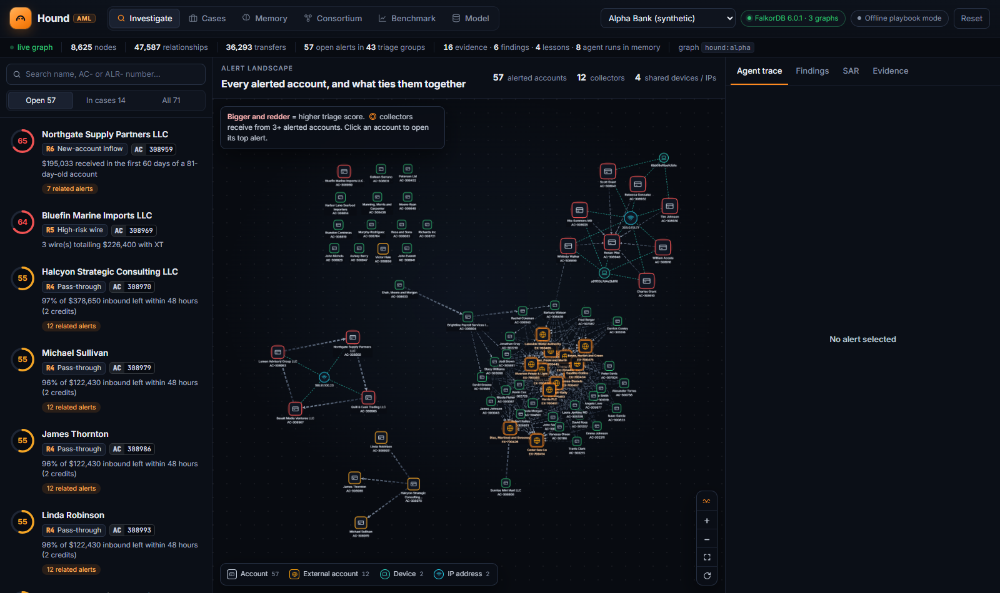
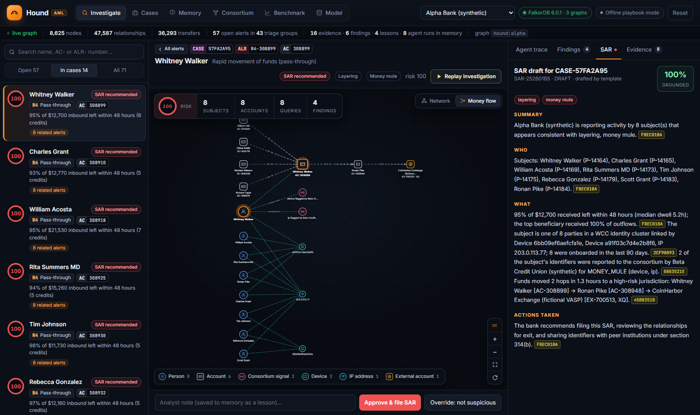
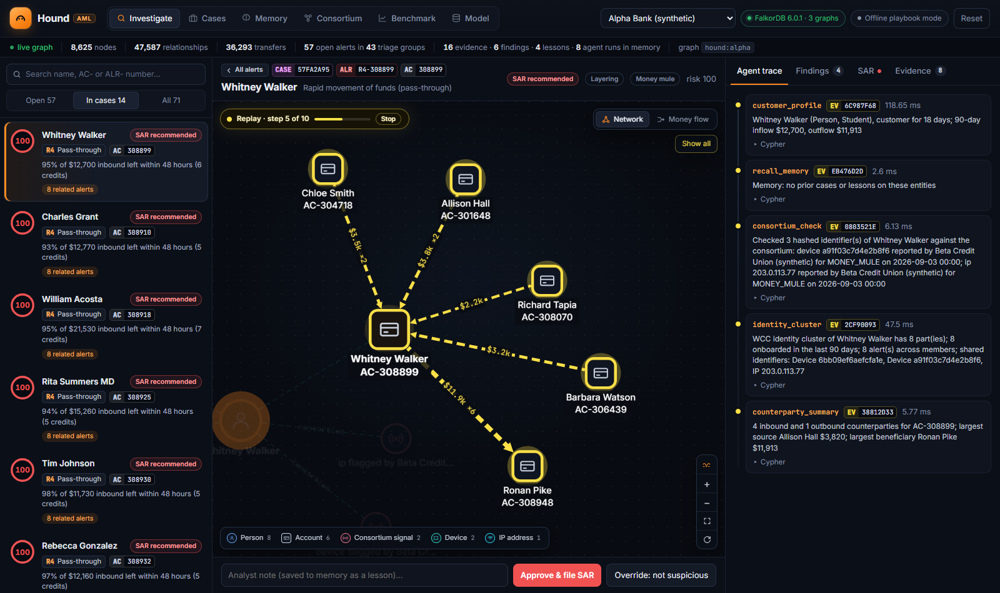
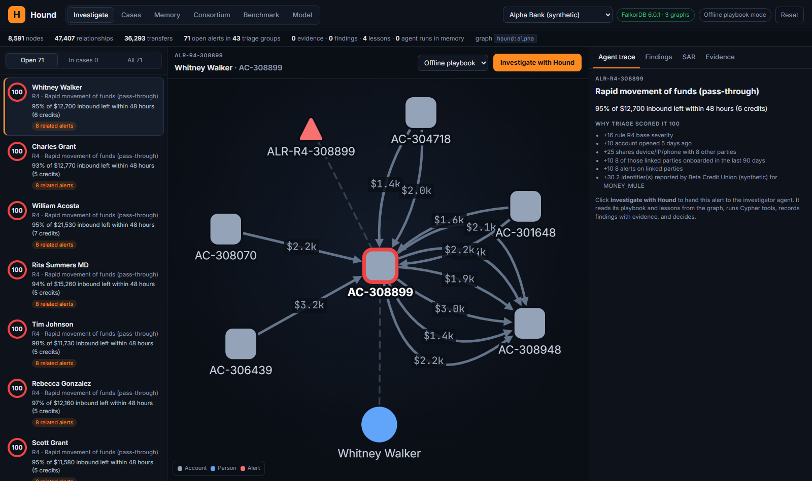
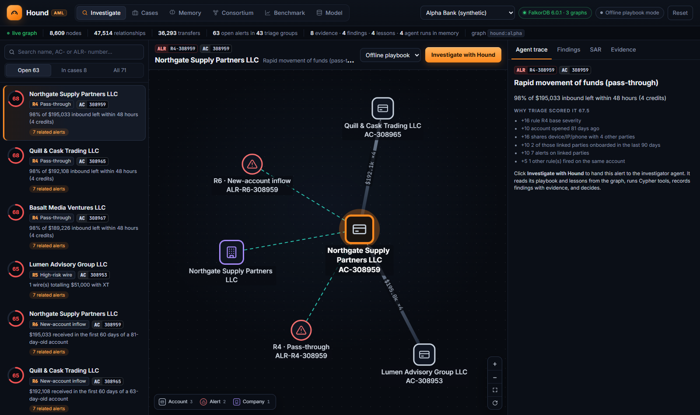
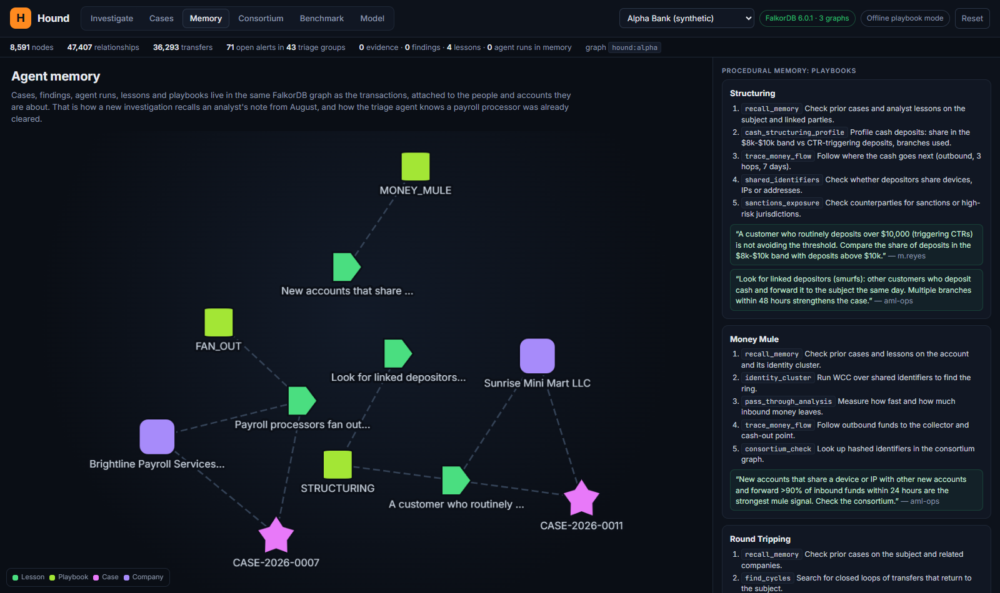
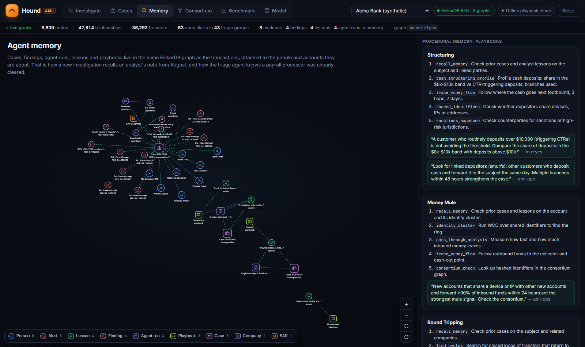

# UI change log

## Round 2 — 2026-10-17: make the graph tell the story

| Alert landscape | Money flow | Replay |
| --- | --- | --- |
|  |  |  |

- **Alert landscape on open.** The empty canvas is now a graph of every alerted account: node size and ring colour follow
  the triage score (red ≥ 60, amber ≥ 35, green below). Dashed teal links show shared devices and IPs. A double orange
  ring marks a **collector**, an account with no alert of its own that receives money from three or more alerted accounts.
  The mule ring, the vendor cluster and the structuring group stand out before anyone clicks.
  Clicking an account opens its highest-scoring alert, and **All alerts** in the case header goes back to the landscape.
  New endpoint: `GET /api/{tenant}/landscape`.
- **Network / Money flow switch** (top right of a case graph). Money flow lays the case out left to right along the transfers:
  senders, then the subject, then beneficiaries and cash-out points (dagre, `cytoscape-dagre@2.5.0`).
  The switch is hidden on overview graphs (landscape, memory, consortium), where a ranked layout can't be read.
- **Money moves.** Transfer edges carry marching dashes in the direction the money went. The wave button
  (bottom right) turns this on or off; during a live run or replay every transfer animates.
  Hovering a node animates just its transfers.
- **Replay investigation.** On a finished case, **Replay investigation** rebuilds the graph one tool call at a time,
  with a progress bar. After each step's layout settles, the camera moves to that step's subgraph, and the agent trace
  fills in alongside. When the replay ends, the camera pulls back to the whole case. Offline mode finishes in about 2 seconds, so this
  is what makes "watch the agent follow the money" visible in a demo.
- **New evidence glows in.** Nodes added mid-investigation fade in with a short yellow glow.
- **Live chip.** "Live · following the money" pulses on the canvas while an investigation streams.
- **Case at a glance.** A floating panel with the risk ring, subjects, accounts, queries and findings (plus the SAR's
  suspicious amount and activity window when Claude drafted it). The typologies moved into the case header.
- **Camera fixes.** "Show all" now zooms back out, not just un-dims. Fit padding scales with canvas height so nodes clear
  the overlays. The overlays compact themselves when the canvas is narrow (container query).
- **Fix.** Edge totals now respect transfer counts that a tool had already summed (e.g. `$23.8k ×12`, not `×1`).
- **Fix.** Node clicks always use the current handler (the old one was captured once at mount).

Files: `backend/src/hound/api.py` (landscape endpoint), `frontend/src/components/GraphCanvas.tsx`,
`frontend/src/views/Investigate.tsx`, `frontend/src/styles.css`, `frontend/src/api.ts`, `frontend/package.json`.

## Round 1 — 2026-10-17: visual pass

A visual pass over the Hound web app: the graph, how nodes are named, the Investigate screen and the app shell.
No agent, rule or scoring logic changed; the one backend change adds data the graph needs (account holder names).

| Before | After |
| --- | --- |
|  |  |
|  |  |

More: [a finished case](ui/after-case.png) · [hover card on a node](ui/after-hover.png)

## 1. Node names: no more bare AC- / ALR- numbers

Before, account nodes showed only `AC-308899` and alert nodes `ALR-R4-308899`, so the graph read as a wall of numbers.
Every node now has a two-line caption: **who or what it is**, then **its identifier**.

| Node | Before | After |
| --- | --- | --- |
| Account | `AC-304718` | **Chloe Smith** / `AC-304718` |
| External account | `EX-700513` | **CoinHarbor Exchange** / `EX-700513 · XQ` (country shown when not US) |
| Alert | `ALR-R4-308899` | **R4 · Pass-through** / `ALR-R4-308899` |
| Case | `CASE-2026-0007` | **Case 2026-0007** / False positive |
| Playbook | `MONEY_MULE` | **Money mule** / playbook |
| Lesson | `New accounts that share ...` | **“New accounts that share…”** / lesson |

- Rule codes get short names everywhere: R1 Structuring, R2 Fan-out, R3 Fan-in, R4 Pass-through, R5 High-risk wire, R6 New-account inflow.
- Outside the graph, identifiers render as two-tone **ID chips** (`AC | 308899`, `ALR | R4-308899`, `CASE | 57FA2A95`, `EV | F8EC01BA`),
  coloured by type: accounts slate, alerts red, cases pink, evidence yellow, parties blue, external accounts amber.
  They appear in the alert queue, the case header, the agent trace, the evidence list, the Cases table and the consortium table.
- When an evidence subgraph later returns the same account with only its number, the holder name is kept instead of being overwritten.

## 2. Graph

- **Icon nodes**: dark fill, coloured ring and a line icon per type (person, building, card, globe, laptop, wifi, phone,
  mail, pin, bank, briefcase, bulb, broadcast, bot, flag, document, warning, book). Sanctioned and blocked parties are octagons.
- **Subject and alert emphasis**: the account under review is larger with an orange ring and glow; alerted accounts get a red glow.
- **Parallel transfers merged**: several transfers between the same two accounts become one edge labelled with the total
  and count (`$23.8k ×7`) instead of seven overlapping lines and labels.
- **Edge width follows money**: thicker lines for larger totals; transfer edges fade from source to target to show direction.
  Ownership edges are violet, shared-identifier links are dashed teal.
- **Hover cards**: hovering a node dims everything except its direct connections and shows a card with type, name, ID,
  holder, account type, bank, rule, outcome and country. Hovering an edge shows the total and number of transfers.
- **Click a node** to focus it together with its neighbours (previously it isolated the single node).
- **Zoom controls** (zoom in, zoom out, fit, re-run layout) in the bottom-right corner.
- **Legend** shows the icon and a count per type; click a type to hide or show it.
- **Layout**: labels are included in collision spacing, small graphs no longer zoom to 300% (capped at 150% on fit),
  overlapping layout runs while evidence streams in are stopped before the next starts, and the canvas resizes with its container.
- **Canvas**: subtle dot-grid background; labels sit on a dark pill so they stay readable over edges.

## 3. Investigate screen

- **Search box** above the alert queue: filter by holder name, `AC-` number, `ALR-` number, rule or case ID.
- **Alert rows**: SVG score ring, rule chip (`R4 Pass-through`) and the account ID chip, with clearer hierarchy.
- **Case header**: case, alert and account ID chips over the holder name and rule; actions wrap to a second row on narrow screens.
- **Tabs** carry counts (Findings 4, Evidence 8) and a red dot when a SAR draft exists.
- **Agent trace** is a timeline: a vertical rail with a coloured dot per step (yellow evidence, orange findings, violet memory,
  green review) and a short fade-in as steps stream in.

## 4. App shell and other views

- Logo mark matching the favicon, an `AML` tag, and icons in the main navigation (hidden below 1440px to save room).
- Status pills with indicator dots; the stats strip has dividers and a pulsing "live graph" marker.
- Refined dark palette, consistent radii and borders, gradient primary button, focus rings for keyboard use, slimmer scrollbars.
- Memory: the side card for a clicked node shows its type icon, caption and ID chip.
- Consortium: hashes shortened with the full value on hover, typologies humanised, case references as ID chips.
- Tables: sticky headers and a subtle row hover.

## 5. Backend

- `GET /api/{tenant}/entity/{id}/neighborhood` now returns, for account nodes, the holder's name plus account type and bank,
  and for alert nodes the rule code and rule name. Null fields are dropped from the response.

## Files

- `frontend/src/format.ts` (new): rule short names, node captions, ID prefix colours.
- `frontend/src/components/GraphCanvas.tsx`: node icons, styles, edge merging, hover cards, controls, legend, layout.
- `frontend/src/components/bits.tsx`: `IdChip`, SVG `ScoreRing`.
- `frontend/src/views/Investigate.tsx`, `Memory.tsx`, `Cases.tsx`, `Consortium.tsx`, `components/Trace.tsx`, `App.tsx`: use the above.
- `frontend/src/styles.css`: palette and component styles.
- `backend/src/hound/api.py`: neighborhood enrichment.

## Further ideas (not done)

- Time slider on the Investigate graph to replay transfers in timestamp order (money animation and step replay are done, in round 2).
- Mini-map for large memory graphs.
- Light theme.
- Code-split Cytoscape so the first load is lighter (the bundle is about 700 kB before gzip).
